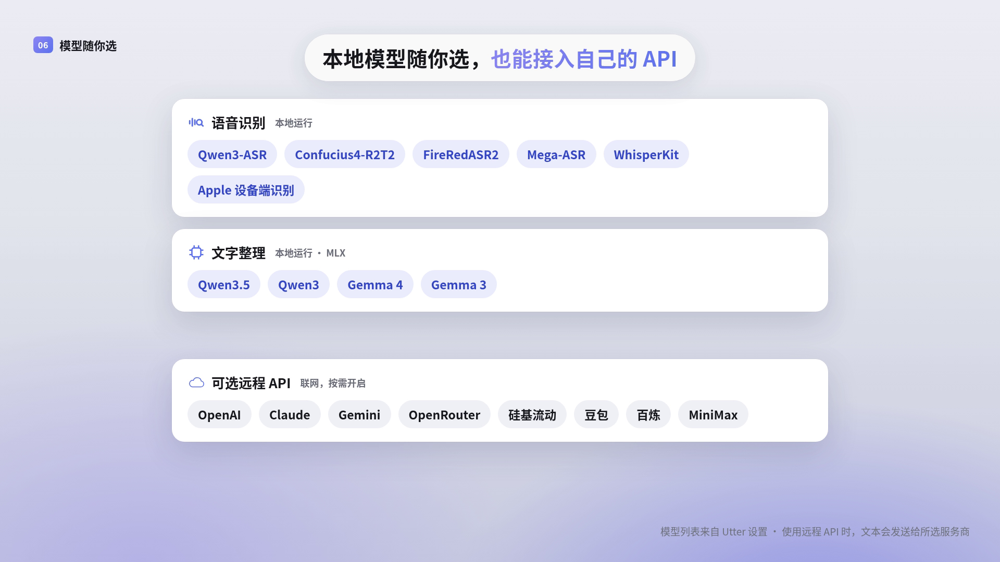
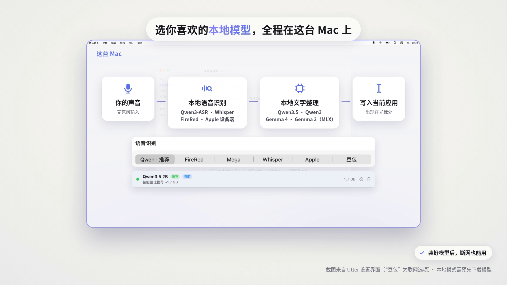

<div align="center">

# Utter

**Local AI-powered voice input for macOS menu bar**

---

[](https://github.com/IchenDEV/utter/stargazers)
[](https://github.com/IchenDEV/utter/network/members)
[](https://github.com/IchenDEV/utter/issues)

[](https://www.apple.com/macos/)
[](https://swift.org)
[](https://www.apple.com/mac/m1/)
[](LICENSE)

[](https://github.com/argmaxinc/argmax-oss-swift)
[](https://github.com/ml-explore/mlx-swift-lm)

[Website](https://utter.idevlab.dev) · [中文文档](README_zh.md)

</div>

---

## Overview

**Utter** is a macOS menu bar app for AI-powered voice input and dictation. It supports both fully local on-device inference and remote LLM APIs. Press a hotkey to start recording, release to transcribe, and the result is typed directly into whatever app you're using.

Three output modes are available:

- **Verbatim** — raw transcription, lowest latency
- **Smart Format** — transcription cleaned up by an LLM (contextual filler removal, grammar fixes, structured formatting)
- **Voice Command** — speak a command and get an AI-generated response based on screen context

## Demo Videos

<p align="center"><a href="https://utter.idevlab.dev/#videos"></a> <a href="https://utter.idevlab.dev/#videos"></a> <a href="https://utter.idevlab.dev/#videos"></a></p>

Watch on the [website](https://utter.idevlab.dev/#videos) or download the MP4s: [Feature tour (0:51)](docs/assets/videos/utter-features-51s-zh-vo.mp4) · [A day at the office (0:58)](docs/assets/videos/utter-day-58s-zh-vo.mp4) · [Local voice input (0:28)](docs/assets/videos/utter-offline-28s-zh-vo.mp4). All three have Mandarin voice-over. The UI is an animated reconstruction of the real app, and the sample texts are illustrative.

## Features

| Feature | Description |
|---|---|
| **Multiple Speech Engines** | Local Qwen3-ASR, Confucius4-R2T2, FireRedASR2, Mega-ASR, WhisperKit, or on-device Apple Speech; Doubao ASR as a remote option |
| **Smart Text Processing** | Local MLX models (Qwen3.5 / Qwen3 / Gemma) or a remote LLM infers spoken intent — contextual cleanup, "scratch that" restarts, self-correction handling, spoken punctuation, technical terms, numbers/ranges/units, and structured formatting |
| **LLM-Owned Spoken Formatting** | Spoken casing, no-space dictation, identifiers, file paths, shortcuts, emoji, Markdown tasks, dates/times, quantities, units, formulas, fractions, and digit sequences are handled by the Smart Format / Voice Command prompts instead of local hardcoded rewrite rules |
| **Voice Edit Commands** | In Voice Command mode, an LLM classifies safe structured actions for replacing, undoing, proofreading, titling, summarizing, drafting replies, making meeting notes, extracting key points/decisions/questions/risks/deadlines/owners/action items, rewriting tone, expanding, making tables/lists, or deleting the previous Utter insertion or selected text |
| **Verbatim & Preview Boundary** | Verbatim mode, streaming HUD, integration partials, and instant-insert drafts keep ASR text close to raw output with only dictionary, whitespace, duplicate, and non-speech-artifact cleanup |
| **Remote LLM Support** | OpenAI, Claude (Anthropic format), Gemini, OpenRouter, SiliconFlow, Doubao, Bailian, MiniMax (CN & Global) |
| **Global Hotkey** | Configurable key (Fn/Ctrl/Shift/Option) with long-press, double-tap, or single-tap activation |
| **Translation Dictation** | Use a dedicated hotkey chord to speak in one language and insert an English, Chinese, Japanese, Korean, Spanish, French, or German translation |
| **Screen Context OCR** | Captures on-screen text via ScreenCaptureKit + Vision to help the LLM correct homophones |
| **Voice Command Mode** | Screen-aware voice assistant — summarize, reply, translate based on what's on screen |
| **Input Memory** | Recent input history injected as LLM context for better continuity |
| **Industry Vocabulary** | Choose Medical, Legal, Finance & Accounting, or Software Technology terms for Apple Speech / Whisper biasing and output normalization; personal terms take priority |
| **Edit Rules** | Personal text replacement rules applied on every output |
| **Language Style Presets** | Casual / Professional / Custom prompt |
| **Input History & Stats** | Full history with raw vs. processed comparison, word count stats, configurable retention |
| **Bilingual UI** | Chinese and English interface, independent of recognition language |
| **Sound Feedback** | Audio cues on recording start and stop |
| **Guided Onboarding** | Step-by-step setup: permissions, model download, and first use |

## System Requirements

- **OS**: macOS 26 (Tahoe) or later
- **Chip**: Apple Silicon (M1 / M2 / M3 / M4)
- **Disk**: ~0.7 GB minimum (Apple Speech + Qwen3.5 0.8B); ~1.8 GB for the default setup (Apple Speech + Qwen3.5 2B); larger speech and text models need several GB more

## Installation

### Download

Grab the latest `.dmg` from [Releases](https://github.com/IchenDEV/utter/releases), open it, and drag **Utter.app** to Applications.

> **"Cannot verify the developer" on first launch?** The app is not notarized by Apple. Before first run, execute in Terminal:
> ```bash
> xattr -cr /Applications/Utter.app
> ```
> Or go to System Settings → Privacy & Security and click "Open Anyway".

### Build from Source

```bash
# Build .app bundle + .dmg installer
bash scripts/build-app.sh

# Or for development
swift build
swift run OpenType

# Build, sign, and launch the development .app bundle
bash scripts/build-and-run.sh --verify

# Or open in Xcode
open Package.swift
```

Material changes follow the artifact-driven workflow in
[`docs/sdlc/README.md`](docs/sdlc/README.md). Before opening a pull request, run:

```bash
bash scripts/sdlc-checks.sh
bash scripts/ci-basic-checks.sh
swift test
```

The public app is `Utter.app`. The Swift package product remains `OpenType` so existing source integrations and upgrade paths continue to work.

## First Run

1. Launch Utter — it appears as a waveform icon in the menu bar
2. The onboarding wizard guides you through permissions and model setup
3. Grant **Microphone** and **Accessibility** permissions (required)
4. Wait for the default text model (Qwen3.5 2B, ~1.7 GB) to download — one time only
5. Hold **Fn** to start dictating, release to stop and insert text

## Permissions

| Permission | Purpose | Required |
|---|---|---|
| Microphone | Audio capture | Yes |
| Accessibility | Global hotkey, text insertion (clipboard + simulated ⌘V), and reading the focused field for context | Yes |
| Speech Recognition | Apple on-device ASR engine | Only if using Apple Speech |
| Screen Recording | OCR for screen context and Voice Command mode | Optional |
| Input Monitoring | Only if you turn on **Settings → Remote → Remap remote buttons**: to see which button of the Xiaomi remote was pressed. Utter listens to that remote only. It is requested when you turn that setting on, never before | Optional |
| Network | Model downloads; remote LLM API calls; daily update checks | First run / remote LLM mode |

## Updates

Utter checks for updates once a day; you can also check manually from **Settings → About** or the menu bar row ("Check for Updates…"). Automatic checks are on by default and can be turned off in the same place.

A check fetches the release feed from GitHub over HTTPS and may follow GitHub CDN redirects. GitHub receives your IP address and Sparkle's User-Agent with the app and Sparkle versions. The check sends no audio, text, history, system profile, or persistent identifier. Sparkle verifies the feed's Ed25519 signature before showing an update. After you choose **Install Update**, it downloads the DMG and verifies it before extraction and installation.

The first release that carries the updater has to be installed manually once. After that, updates apply in place and keep your permissions, settings and history.

## Xiaomi Remote Voice Key

The Xiaomi remote's voice key also sends F5, which macOS treats as the Dictation key and answers by typing stray text such as "I". While **Settings → Remote → Keep the voice key from opening Dictation** is on (the default), Utter turns off that one key on that remote only (Xiaomi RC003, vendor `0x2717`, product `0x32B8`). Other keys and other keyboards are untouched, no extra permission is needed, and the key comes back when you turn the setting off or quit Utter. The remote's own wireless-mic feature does not need to be on.

If something looks wrong:

- Turn the setting off, or run `defaults write com.opentype.voiceinput remoteKeyRemapEnabled -bool false` and relaunch Utter.
- If Utter crashed and the voice key stays dead, reconnect the remote in System Settings → Bluetooth, or clear it by hand: `hidutil property --matching '{"VendorID":10007,"ProductID":12984}' --set '{"UserKeyMapping":[]}'`.
- Without Utter, the workaround is System Settings → Keyboard → Dictation off.

## Xiaomi Remote Button Mapping

With **Settings → Remote → Remap remote buttons** on (off by default), each of the Xiaomi RC003's eleven keys (up, down, left, right, OK, back, home, menu, TV, volume up, volume down) can do something else on a press, a double press or a long press: a keyboard shortcut, a media key, Show Desktop, the app switcher, or opening an app. The voice key is not remappable. The setting needs **Keep the voice key from opening Dictation** above to be on.

- **Permission.** Utter needs **Input Monitoring** to see which button was pressed. macOS asks once, when you turn the setting on; nothing is requested before that. Utter matches only that remote's device, so other keyboards are not listened to, and no key data leaves the Mac. If it still does not work after you allow it, restart Utter.
- **Safety rule.** Utter turns a key off at the device level only while it can see that key's presses. Without the permission, or without the remote, every key keeps its normal job.
- **Limits.** A mapped key triggers once per press and does not repeat while held. Keyboard shortcuts and system actions are not sent while a password field has the keyboard. Show Desktop follows your macOS shortcut. Volume buttons may still change the system volume while Utter handles them.

If something looks wrong:

- Turn the setting off, or run `defaults write com.opentype.voiceinput remoteButtonMappingEnabled -bool false` and relaunch Utter.
- If Utter crashed and remote keys stay dead, reconnect the remote in System Settings → Bluetooth, or clear it by hand: `hidutil property --matching '{"VendorID":10007,"ProductID":12984}' --set '{"UserKeyMapping":[]}'` (this also clears the voice-key entry; relaunch Utter to set it again).
- To withdraw the permission: System Settings → Privacy & Security → Input Monitoring → turn Utter off, or run `tccutil reset ListenEvent com.opentype.voiceinput`.

## Troubleshooting

### Dictated text does not appear in a browser or Electron app

In Chromium-based apps (Electron apps such as Cursor, Chromium browsers such as Dia) macOS accepts a direct Accessibility write into a web page field and reports success, yet nothing appears. For those fields Utter pastes instead, so **Settings → General → Allow clipboard paste** must be on; the previous clipboard contents are restored after a confirmed paste. With it off, those fields receive no insertion and Utter offers an explicit copy.

If Utter cannot confirm that the paste landed, the HUD says the insertion could not be confirmed and offers to copy the text. Utter never inserts it a second time on its own, so paste it yourself with ⌘V.

Fields that do not expose Chromium's accessibility node (for example Safari and Firefox) are not covered and keep using the direct write.

To return to the previous behavior without a new build, run `defaults write com.opentype.voiceinput deliveryWebEditorPasteDisabled -bool true`; undo it with `defaults delete com.opentype.voiceinput deliveryWebEditorPasteDisabled`. It applies to the next dictation; restart Utter if it does not.

### Utter will not reopen after an update

If the menu bar icon disappears during an update and opening Utter again does nothing, the previous copy never finished quitting and is still running, so the installer is waiting for it. Force-quit it once: in Activity Monitor select Utter and choose Force Quit, or run `pkill -9 -x Utter` in Terminal. The update then installs and Utter relaunches; if it does not, open Utter again.

From 0.0.60 on, a quit that does not finish within 5 seconds ends on its own, and the system log (subsystem `com.opentype.voiceinput`, message starting `Shutdown exceeded`) names the part that held it up. Updating from an older version can still need the one force-quit above.

## Local Models

Everything below runs on your Mac. Download a model once and dictation keeps working with the network off.

| Stage | Models | Notes |
|---|---|---|
| Speech recognition | Qwen3-ASR 1.7B (recommended), Confucius4-R2T2, FireRedASR2-AED, Mega-ASR, WhisperKit (large-v3-turbo … tiny), Apple Speech (on-device) | Qwen3-ASR and Confucius run through native Swift + MLX; FireRed and Mega-ASR through MLX; Apple Speech is forced on-device |
| Text cleanup (LLM) | Qwen3.5 0.8B / **2B (default)** / 9B / 35B-A3B, Qwen3 0.6B–30B-A3B, Qwen2.5, Gemma 4 E2B / E4B, Gemma 3 1B / 4B / 12B | MLX on Apple Silicon; an experimental ANE-LM runtime can run a local Qwen3 model; you can also add your own MLX model |

Remote options are opt-in: Doubao (Volcengine) ASR and the remote LLM providers below send audio or text to that provider.

## Remote LLM Providers

Utter supports both **OpenAI-compatible** and **Anthropic** API formats:

| Provider | API Format | Base URL |
|---|---|---|
| OpenAI | OpenAI | `https://api.openai.com/v1` |
| Anthropic Claude | Anthropic | `https://api.anthropic.com/v1` |
| Google Gemini | OpenAI | `https://generativelanguage.googleapis.com/v1beta/openai` |
| OpenRouter | OpenAI | `https://openrouter.ai/api/v1` |
| SiliconFlow | OpenAI | `https://api.siliconflow.cn/v1` |
| Volcengine Doubao | OpenAI | `https://ark.cn-beijing.volces.com/api/v3` |
| Alibaba Bailian | OpenAI | `https://dashscope.aliyuncs.com/compatible-mode/v1` |
| MiniMax (China) | OpenAI | `https://api.minimax.chat/v1` |
| MiniMax (Global) | OpenAI | `https://api.minimaxi.chat/v1` |

## Project Structure

Built-in features are replaceable plugins assembled by `UtterBuiltins`.
See [plugin composition](docs/plugin-composition.md) and
[local voice evaluation](docs/voice-evaluation.md).

```text
Sources/
├── App/                       # Application startup and shutdown
├── UtterRuntime/              # Plugin dependency graph and lifecycle
├── UtterContracts/            # Shared services, values, localization
├── UtterMediaContracts/       # Speech, processing, image contracts
├── UtterPresentationContracts/ # UI projections and contributions
├── UtterData/                 # Settings, history, vocabulary, composition
├── UtterModels/               # Asset leases, downloads, model lifecycle
├── UtterProcessing/           # Prompts, processing and fidelity checks
├── UtterSession/              # Shared workflow and delivery coordination
├── UtterIngress/              # Fn, remote microphone, HTTP and XPC
├── UtterPresentation/         # Menu, settings, onboarding, HUD and assets
├── UtterBuiltins/             # Built-in registrations and application assembly
└── Utter*/                    # Audio, macOS, speech and inference providers
```

Build and validation scripts live under `scripts/`. `build-app.sh` builds the
release app and installer; `evaluate-voice.sh` runs installed local models
through production processing without writing to the cursor.

## Tech Stack

- [WhisperKit](https://github.com/argmaxinc/argmax-oss-swift) — offline Whisper speech recognition
- [mlx-swift-lm](https://github.com/ml-explore/mlx-swift-lm) — local LLM inference on Apple Silicon (Qwen3.5 / Qwen3 / Gemma)
- **SwiftUI + AppKit** — native macOS UI
- **ScreenCaptureKit + Vision** — screen OCR
- **AVAudioEngine** — low-latency microphone capture
- **Apple Speech Framework** — on-device speech recognition
- **Qwen3-ASR / FireRedASR2 / Mega-ASR on MLX** — local speech recognition

## License

[MIT](LICENSE)

---

<div align="center">

Made with care for Apple Silicon

</div>
